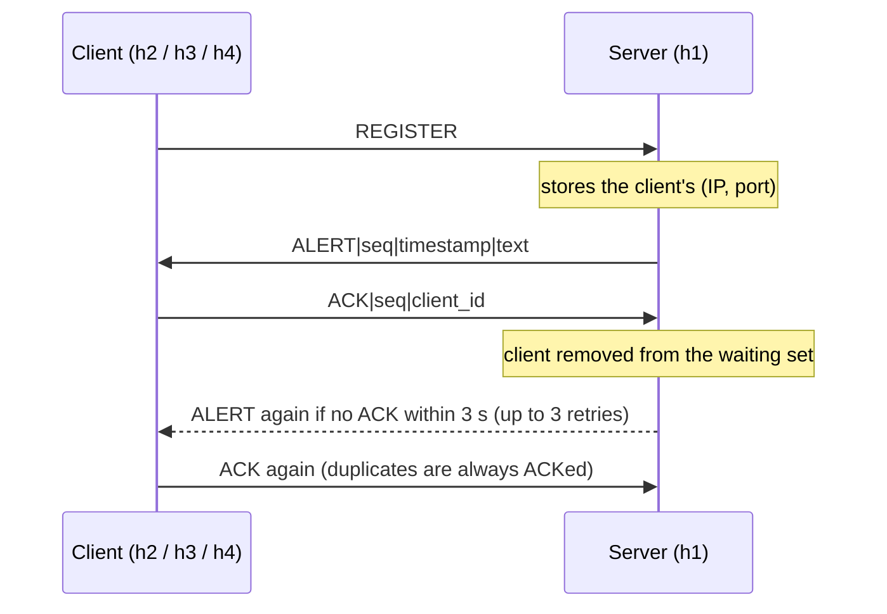
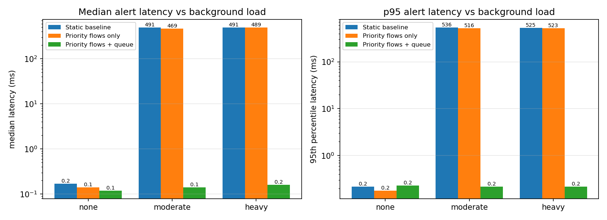
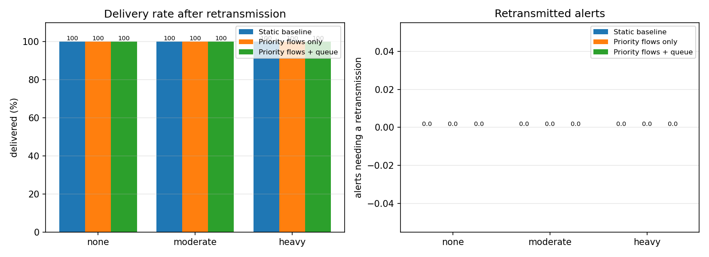
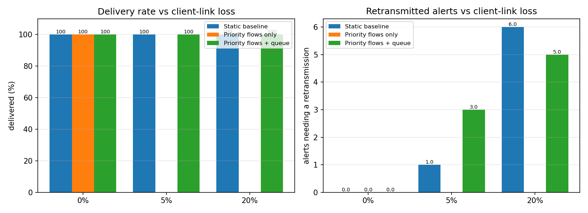

# Emergency Notification Network (UDP + Mininet + SDN)

A UDP-based emergency notification system. A server sends urgent alerts to
several registered clients and makes delivery reliable at the application layer
(ACKs + retransmission). The system runs on a **Mininet** network whose switches
are controlled by a **Ryu SDN controller** that recognises emergency traffic and
forwards it with higher priority, so alerts still arrive quickly when the network
is congested.

Project for the **SDN – Socket Programming (Jackfruit) mini project**.

---

## Table of contents

1. [Repository branches](#1-repository-branches)
2. [Network topology](#2-network-topology)
3. [System design and protocol](#3-system-design-and-protocol)
4. [SDN controller design](#4-sdn-controller-design)
5. [File reference](#5-file-reference)
6. [Requirements and installation](#6-requirements-and-installation)
7. [How to run](#7-how-to-run)
8. [Experiments](#8-experiments)
9. [Results](#9-results)
10. [Link-failure test](#10-link-failure-test)
11. [Requirements coverage](#11-requirements-coverage)
12. [Known limitations](#12-known-limitations)
13. [Team](#13-team)

---

## 1. Repository branches

The project lives in two branches.

| Branch | Purpose | Contents |
|---|---|---|
| **`main`** | The UDP application on its own, for local development and testing on one machine (`127.0.0.1`) | `server.py`, `client.py`, `test_ack.py`, `test_multi_client.py` (localhost versions) |
| **Second branch** | The full Mininet + SDN project | Mininet-ready `server.py`, `client.py`, `test_ack.py`, `test_multi_client.py`, plus `topology.py`, `emergency_topo.py`, `emergency_controller.py`, `run_experiments.py`, `plot_results.py` and the `results/` folder |

The two branches differ in the application files:

| File | `main` (localhost) | Second branch (Mininet-ready) |
|---|---|---|
| `server.py` | binds to `127.0.0.1:5000` only | `--host` option, binds to `0.0.0.0` by default so hosts on other Mininet nodes can reach it |
| `client.py` | default `--server 127.0.0.1` | default `--server 10.0.0.1` (host `h1`) |
| `test_ack.py` | hard-coded `127.0.0.1` | `--server`, `--port`, `--duration` options |
| `test_multi_client.py` | hard-coded `127.0.0.1`, 3 threads | `--server`, `--clients`, `--duration`, `--silent-client` options |

Use the **second branch** for anything involving Mininet, the controller or the
experiments. `run_experiments.py` needs the Mininet-ready `server.py`.

---

## 2. Network topology

```
                        Ryu SDN controller
                      (emergency_controller.py)
                       OpenFlow 1.3 over TCP 6653
                         |                  |
                         |                  |
 h1  SERVER 10.0.0.1 ----+                  +---- h2  CLIENT 10.0.0.2
 (UDP 5000)              |                  |     h3  CLIENT 10.0.0.3
                       +-+--+  bottleneck  +-+--+  h4  CLIENT 10.0.0.4
                       | s1 |==============| s2 |  (UDP 5001 on each client)
                       +-+--+  2 Mbit/s     +-+--+
 h5  BG SOURCE 10.0.0.5 -+   (default, --bw)  +---- h6  BG SINK 10.0.0.6
 (iperf client)                                      (iperf server)
```

The same topology as a diagram (renders on GitHub):

```mermaid
flowchart LR
    CTRL["Ryu controller<br/>emergency_controller.py"]
    H1["h1 · SERVER<br/>10.0.0.1 · UDP 5000"]
    H5["h5 · background source<br/>10.0.0.5 · iperf client"]
    S1(["s1"])
    S2(["s2"])
    H2["h2 · CLIENT c1<br/>10.0.0.2 · UDP 5001"]
    H3["h3 · CLIENT c2<br/>10.0.0.3 · UDP 5001"]
    H4["h4 · CLIENT c3<br/>10.0.0.4 · UDP 5001"]
    H6["h6 · background sink<br/>10.0.0.6 · iperf server"]

    H1 --- S1
    H5 --- S1
    S1 == "bottleneck link (default 2 Mbit/s)" === S2
    S2 --- H2
    S2 --- H3
    S2 --- H4
    S2 --- H6
    CTRL -. OpenFlow 1.3 .- S1
    CTRL -. OpenFlow 1.3 .- S2
```

### Nodes

| Host | IP | Role | Switch |
|---|---|---|---|
| h1 | 10.0.0.1 | Notification **server** (`server.py`) | s1 |
| h5 | 10.0.0.5 | Background traffic **source** (`iperf -c`, UDP) | s1 |
| h2 | 10.0.0.2 | **Client** `c1` (`client.py`) | s2 |
| h3 | 10.0.0.3 | **Client** `c2` | s2 |
| h4 | 10.0.0.4 | **Client** `c3` | s2 |
| h6 | 10.0.0.6 | Background traffic **sink** (`iperf -s`, UDP port 5002) | s2 |

Both switches are Open vSwitch running OpenFlow 1.3 and connect to a remote
controller on `127.0.0.1:6653`.

### Why this shape

Everything the server sends to the clients, and everything the background source
sends to the sink, must cross the single **s1 – s2** link. Limiting that link
creates a congestion point on purpose, so the effect of prioritising emergency
traffic can be measured.

### Link parameters (`topology.py`)

| Link | Setting |
|---|---|
| s1 – s2 (default mode) | `TCLink` with `--bw` Mbit/s (default **2**), `--delay` (default 5 ms; the experiments use none), `max_queue_size=100` |
| s1 – s2 (`--qos` mode) | plain link; rate limiting is done by **Open vSwitch HTB queues** on both trunk ports instead (see below) |
| h2, h3, h4 – s2 | optional packet loss with `--loss` (percent) |
| all other host links | unshaped |

Ports follow link-creation order: on s1 the trunk is **port 3**, on s2 it is
**port 1**. The controller relies on this (`TRUNK_PORTS = {1: 3, 2: 1}`).

### OVS queues (`--qos` mode)

`setup_ovs_queues()` configures a `linux-htb` QoS on both ends of the trunk:

| Queue | Use | Minimum rate | Maximum rate | Priority |
|---|---|---|---|---|
| 1 | **emergency** traffic | 80 % of the link | link rate | 0 (highest) |
| 0 | everything else | 10 % of the link | link rate | 1 |

### Simpler star topology

`emergency_topo.py` builds a single-switch star (`h1` as server, `h2…` as
clients, optional `--loss`) without a remote controller. It is meant for
testing the application alone, before the bottleneck topology and controller are
involved.

---

## 3. System design and protocol

### Components

| Component | File | Role |
|---|---|---|
| Server | `server.py` | Registers clients, sends alerts, tracks ACKs, retransmits, can generate `BG\|` background messages |
| Client | `client.py` | Registers, receives alerts, ACKs them, logs latency |
| SDN controller | `emergency_controller.py` | Learning switch, emergency flow priorities, optional queue, link-failure handling |
| Topology | `topology.py` | Mininet network with the bottleneck |
| Experiments | `run_experiments.py`, `plot_results.py` | Automated runs, tables and graphs |

### UDP ports

| Port | Used by | Purpose |
|---|---|---|
| **5000** | server | `REGISTER` and `ACK` from clients |
| **5001** | each client | `ALERT` messages (**the port the controller treats as emergency traffic**) |
| 5002 | iperf (h6) | background congestion traffic |

### Messages

Plain UTF-8 text in single UDP datagrams, fields separated by `|`.

| Direction | Message | Meaning |
|---|---|---|
| client → server | `REGISTER` | Subscribe to alerts. The server stores the sender's `(IP, port)` |
| server → client | `ALERT\|<seq>\|<timestamp>\|<text>` | Emergency alert; `timestamp` is `time.time()` at the server |
| client → server | `ACK\|<seq>\|<client_id>` | Delivery confirmation for alert `<seq>` |
| server → client | `BG\|Normal traffic <n>` | Optional background messages (`bg start`); clients ignore them |

### Reliable delivery on top of UDP



* **Server:** `ACK_TIMEOUT = 3` s and `MAX_RETRIES = 3` (up to 4 transmissions,
  about 12 s per alert). Each retry goes only to clients that have not ACKed.
  After the last attempt it prints `delivery NOT confirmed for …`.
* **Client:** re-sends `REGISTER` after 5 s without an alert (in case the first
  one was lost), always ACKs every alert, **including duplicates** (so a lost ACK
  does not make the server retry until it gives up), and logs each sequence
  number only once.
* **Same socket for everything:** the client registers, receives and ACKs from
  one socket, because the server matches an ACK to the sender's `(IP, port)`.
* **Latency:** `latency_ms = (recv_ts − send_ts) × 1000`, using the server's
  timestamp. This is valid in Mininet because all hosts share one machine clock.
  A retransmitted alert keeps its original timestamp, so its latency includes
  the retransmission wait.

### Server console commands

```
alert <text>   send an alert to all registered clients, retransmit until ACKed
bg start       start background BG| traffic (every 0.5 s)
bg stop        stop it
quit           shut down
```

---

## 4. SDN controller design

`emergency_controller.py` is a Ryu application (OpenFlow 1.3).

### Flow priorities

| Priority | Match | Action | Purpose |
|---|---|---|---|
| 100 | `eth_type=0x0800, ip_proto=17, udp_dst=5001, eth_dst=<host>` | output (+ `set_queue` 1 on the trunk port in queue mode) | **Emergency alerts** |
| 50 | `eth_type=0x0800, ip_proto=17, udp_dst=5000, eth_dst=<host>` | output | `REGISTER` / `ACK` traffic, so ACKs are not starved |
| 10 | `in_port, eth_src, eth_dst` | output | Ordinary learned L2 forwarding (idle timeout 30 s) |
| 0 | any | send to controller | Table-miss |

The emergency and control flows are installed **proactively** as soon as a host's
MAC address is learned, so a lower-priority L2 flow created earlier (for example
by ARP) can never hide emergency traffic from the priority rule.

### Operating modes (environment variables)

| Mode | How to start the controller | Topology | What it does |
|---|---|---|---|
| `baseline` | `EMERGENCY_MODE=0 ryu-manager emergency_controller.py` | `topology.py` | Static learning switch, no prioritisation |
| `emergency` | `ryu-manager emergency_controller.py` | `topology.py` | Priority-100 flows for UDP 5001, **no queue** |
| `queue` | `USE_QUEUE=1 ryu-manager emergency_controller.py` | `topology.py --qos` | Priority flows **plus** the OVS priority queue |

### Link failure

On a port-status event the controller logs the change, deletes every flow on that
switch, forgets its learned MAC addresses and reinstalls the table-miss rule, so
paths are relearned after a link goes down or comes back up.

`self.datapaths` holds every connected switch, ready for port-statistics
polling.

---

## 5. File reference

### `main` branch

| File | Description |
|---|---|
| `server.py` | UDP server, localhost version (`127.0.0.1:5000`) |
| `client.py` | UDP client, default server `127.0.0.1`; `--port` lets several clients share one PC |
| `test_ack.py` | Single stub client on `127.0.0.1:5001`: registers, receives one alert, ACKs |
| `test_multi_client.py` | Three stub clients in threads; `client_3` deliberately never ACKs, to exercise retransmission and the "not confirmed" path |

### Second branch

| File | Description |
|---|---|
| `server.py` | UDP server for Mininet (`--host`, `--port`; default `0.0.0.0:5000`); handles `EOFError` so it keeps running when started in the background |
| `client.py` | UDP client (`python3 client.py <client_id> [--server 10.0.0.1] [--port 5001]`); writes `logs/client_<id>.csv` |
| `test_ack.py` | Single-client ACK test with `--server`, `--port`, `--duration`; run on a client host, not together with `client.py` (both use port 5001) |
| `test_multi_client.py` | Several simulated clients on one host (`--clients`, `--silent-client`, default: the last client does not ACK) |
| `topology.py` | Mininet bottleneck topology (`--bw`, `--delay`, `--loss`, `--qos`, controller IP/port) and `setup_ovs_queues()` |
| `emergency_topo.py` | Simple single-switch star topology for testing the application alone |
| `emergency_controller.py` | Ryu controller (Section 4) |
| `run_experiments.py` | Automated experiment runner (Section 8) |
| `plot_results.py` | Builds the graphs and `results_table.md` from `results/results.csv` |
| `results/results.csv` | One row per experiment run |
| `results/results_table.md` | The same results as a Markdown table |
| `results/link_failure.txt` | Output of the link-failure test |
| `results/latency_by_load.png`, `delivery_by_load.png`, `loss_scenarios.png` | Result graphs |
| `results/raw/<run>/` | Per-run `server.log`, `ryu.log` and `logs/client_c*.csv` (created by the runner) |

### Client log format

`logs/client_<client_id>.csv` is created in the folder the client is started from,
one row per **new** sequence number (duplicates are ACKed but not logged):

| Column | Meaning |
|---|---|
| `seq` | alert sequence number |
| `send_ts` | server timestamp carried in the alert |
| `recv_ts` | time the client received it |
| `latency_ms` | `(recv_ts − send_ts) × 1000` |

---

## 6. Requirements and installation

* Ubuntu 20.04 / 22.04 with Python 3 (Ryu does not run on very new Python
  versions; on Ubuntu 24.04 use a Python 3.9 environment or the `os-ken` fork)
* Mininet, Open vSwitch, `iperf` (for the experiments) and Ryu

```bash
sudo apt update
sudo apt install -y mininet openvswitch-switch iperf python3-venv python3-pip python3-matplotlib
sudo systemctl enable --now openvswitch-switch

python3 -m venv --system-site-packages ~/ryu-env
~/ryu-env/bin/pip install --upgrade pip wheel "setuptools<=67.6.1" "eventlet==0.30.2"
~/ryu-env/bin/pip install --no-build-isolation ryu
```

The server, client and test scripts use only the Python standard library.
`plot_results.py` needs `matplotlib`.

Quick check:

```bash
sudo mn --test pingall
~/ryu-env/bin/ryu-manager --version
```

---

## 7. How to run

### A. Application only, on one machine (`main` branch)

```bash
python3 server.py                          # terminal 1

python3 client.py c1 --port 5001           # terminals 2-4 (one port per client)
python3 client.py c2 --port 5002
python3 client.py c3 --port 5003
```

In the server terminal: `alert Fire in building A`. Each client prints the alert
with its latency; the server prints `ACK received for alert 1 from c1 …` and
`Alert 1: all clients ACKed`.

Stub-client tests (with the server running):

```bash
python3 test_ack.py             # one stub client on port 5001
python3 test_multi_client.py    # three stub clients, client_3 never ACKs
```

### B. Full network, manual demo (second branch)

```bash
# terminal 1 – controller (choose a mode, see Section 4)
ryu-manager emergency_controller.py                 # priority flows only
# USE_QUEUE=1 ryu-manager emergency_controller.py   # + OVS queue (needs --qos)
# EMERGENCY_MODE=0 ryu-manager emergency_controller.py   # baseline

# terminal 2 – topology (run from the project folder)
sudo python3 topology.py                # TCLink bottleneck
# sudo python3 topology.py --qos        # OVS priority queues on the bottleneck
# sudo python3 topology.py --bw 1 --loss 5
```

Inside the `mininet>` prompt:

```
mininet> pingall                                  # must pass before starting the app
mininet> xterm h1 h2 h3 h4 h5 h6
```

```
h1:  python3 server.py
h2:  python3 client.py c1
h3:  python3 client.py c2
h4:  python3 client.py c3
h1 (server prompt):  alert Fire in building A
```

Create congestion and compare:

```
h6:  iperf -s -u -p 5002
h5:  iperf -c 10.0.0.6 -u -p 5002 -b 10M -t 60
h1 (server prompt):  alert Fire again
```

Inspect the flow table and test a link failure:

```
mininet> sh ovs-ofctl -O OpenFlow13 dump-flows s1
mininet> link s1 s2 down
mininet> link s1 s2 up
```

### C. Automated experiments (second branch)

Run from the project folder (needs root for Mininet and `iperf` installed):

```bash
sudo python3 run_experiments.py                          # 3 modes x 3 loads, no loss
sudo python3 run_experiments.py --losses 5 20 --loads none --modes baseline queue
sudo python3 run_experiments.py --link-failure --modes queue   # link-failure test only (uses the first mode listed)
python3 plot_results.py                                  # graphs + table, no sudo
```

The runner looks for Ryu at `~/ryu-env/bin/ryu-manager`; use
`--ryu /path/to/ryu-manager` if yours is elsewhere. Other options: `--alerts`
(default 8 per run), `--bw` (bottleneck, default 2 Mbit/s), `--gap`, `--settle`,
`--out`.

---

## 8. Experiments

For every combination of **controller mode × background load × client-link loss**
`run_experiments.py` starts Ryu, builds the topology, starts the server and three
clients, sends a warm-up alert (not measured; it installs the flows), starts the
background load, sends the measured alerts, collects the numbers and tears
everything down.

| Parameter | Values |
|---|---|
| Mode | `baseline` (static learning switch), `emergency` (priority flows, no queue), `queue` (priority flows + OVS queue) |
| Load | `none` = 0, `moderate` = 1× the bottleneck, `heavy` = 5× the bottleneck (with the default 2 Mbit/s bottleneck: **0, 2 and 10 Mbit/s** of UDP via `iperf`, h5 → h6) |
| Client-link loss | 0 % by default; 5 % and 20 % in the loss scenarios |
| Measured alerts | 8 per run to 3 clients = **24** deliveries, 1 s apart, after a 5 s settle time |

### Metrics

| Metric | How it is measured |
|---|---|
| Latency (`mean`, `median`, `p95`, `max`) | `latency_ms` from the client logs, for the measured alerts only |
| Delivery rate | unique measured alerts logged by the clients ÷ expected (alerts × 3 clients) |
| Alerts retransmitted / datagrams re-sent | parsed from the server's `Alert N: attempt K, sent to M waiting client(s)` lines |
| First-attempt failure % | (alert, client) pairs that still needed an attempt 2 ÷ expected; an alert **or** its ACK being lost both count |
| Unconfirmed | alerts for which the server printed `delivery NOT confirmed` |

If a configuration is run more than once, `plot_results.py` uses its most recent row.

---

## 9. Results

Default setup: 2 Mbit/s bottleneck, 8 measured alerts × 3 clients per run.

### Latency and delivery vs background load (no link loss)

| Mode | Load | Delivered % | Median ms | p95 ms | Max ms | Retx alerts |
|---|---|---|---|---|---|---|
| Static baseline | none | 100 | 0.17 | 0.22 | 0.25 | 0 |
| Priority flows only | none | 100 | 0.14 | 0.18 | 0.20 | 0 |
| Priority flows + queue | none | 100 | 0.12 | 0.23 | 0.25 | 0 |
| Static baseline | moderate (2 Mbit/s) | 100 | 490.93 | 536.29 | 536.61 | 0 |
| Priority flows only | moderate | 100 | 468.77 | 516.26 | 516.57 | 0 |
| Priority flows + queue | moderate | 100 | **0.14** | **0.22** | 0.22 | 0 |
| Static baseline | heavy (10 Mbit/s) | 100 | 490.92 | 524.66 | 524.95 | 0 |
| Priority flows only | heavy | 100 | 488.65 | 523.34 | 523.64 | 0 |
| Priority flows + queue | heavy | 100 | **0.16** | **0.22** | 0.34 | 0 |





**What this shows**

* With no load all modes are fast (about 0.1–0.2 ms).
* Under load, **baseline and priority-flows-only** alerts wait about half a second
  behind the background traffic in the bottleneck's single queue. Priority flows
  alone do not help, because they only change which flow-table rule matches; the
  packets still share one queue.
* **Priority flows + OVS queue** keeps alert latency at about 0.1–0.2 ms even
  under heavy load, a drop of roughly three orders of magnitude.
* Delivery is 100 % and no retransmission is needed under load, because the
  queueing delay (about 0.5 s) is well below the 3 s ACK timeout.

### Packet loss on the client links (no background load)

| Mode | Client-link loss | Delivered % | Median ms | p95 ms | Max ms | Retx alerts | 1st-attempt fail % | Unconfirmed |
|---|---|---|---|---|---|---|---|---|
| Static baseline | 5 % | 100 | 0.15 | 0.24 | 0.27 | 1 | 4.17 | 0 |
| Priority flows + queue | 5 % | 100 | 0.13 | 3004.61 | 3005.14 | 3 | 12.5 | 0 |
| Static baseline | 20 % | 100 | 0.19 | 6009.28 | 6009.36 | 6 | 33.33 | 1 |
| Priority flows + queue | 20 % | 100 | 0.18 | 3005.65 | 6010.91 | 5 | 25.0 | 0 |



**What this shows**

* Retransmission recovers lost alerts: **100 % delivery at 5 % and 20 % loss**.
* Recovered alerts show up as latencies of about 3 s (one retry) or 6 s (two
  retries), matching the 3 s ACK timeout.
* The one "unconfirmed" alert at 20 % loss was delivered (the client logged it)
  but all its ACKs were lost, so the server could not confirm it.
* Loss affects all modes the same way (the loss is on the client links, not the
  bottleneck). With only 24 deliveries per run, the differences between the rows
  are random variation and should not be read as one mode being better.
  `emergency`-only was not run in the loss scenarios.

---

## 10. Link-failure test

`sudo python3 run_experiments.py --link-failure --modes queue` (output in
`results/link_failure.txt`): send an alert, take the s1–s2 link down, send an alert,
bring the link back up, send a third alert.

```
Link failure test (mode=queue)
deliveries per alert: {1: 3, 3: 3}
controller flush events: 6
[PASS] alert before failure delivered to all 3 clients
[PASS] alert during failure not delivered
[PASS] alert after recovery delivered to all 3 clients
[PASS] controller flushed flows on port-status events
```

The alert sent while the only path between the switches was down could not be
delivered; after the link came back the controller had flushed and relearned the
flows, and the next alert reached all three clients.

---

## 11. Requirements coverage

| Requirement | Where it is met |
|---|---|
| UDP notification delivery | `server.py`, `client.py` |
| Register multiple subscribers | `REGISTER` handling; three clients (h2, h3, h4) |
| Delivery confirmation | `ACK` messages, 3 s timeout, 3 retries |
| Emergency traffic classification | priority-100 flows matching UDP port 5001 |
| High-priority SDN forwarding | priority flows plus OVS priority queue |
| Congestion scenarios | `iperf` background load (none / moderate / heavy) |
| Notification latency and packet loss | per-client logs and the server log, analysed by `run_experiments.py` |
| Baseline comparison | `baseline` mode (static learning switch) vs `emergency` and `queue` |
| Robustness | packet loss on client links, link-failure test |

---

## 12. Known limitations

* The server handles one alert at a time: `alert` blocks the prompt until every
  client ACKs or the retries end (up to about 12 s).
* There is no `UNREGISTER`; a client that quits stays registered until the server
  restarts.
* The topology has a single path between the switches, so the link-failure test
  checks recovery after the link returns, not rerouting over an alternative path.
* `REGISTER`/`ACK` traffic (UDP port 5000) gets a priority-50 flow but is not
  placed in the emergency queue; only alerts (port 5001) use the queue.
* `BG|` background messages from the server also go to port 5001, so the
  controller treats them as emergency traffic; they are tiny and the experiments
  use `iperf` (port 5002) for the real background load.
* Each run uses 8 alerts × 3 clients, so the loss-scenario results are small
  samples.
* The localhost files on `main` and the Mininet-ready files on the second branch
  have the same names; make sure you run the version that matches your setup.
* Do not commit compiled `__pycache__/*.pyc` files.

---

## 13. Team

| Member | Responsibility |
|---|---|
| A | `server.py` and the server side of the protocol |
| B | `client.py` (UDP client and per-client log) |
| C | `topology.py` and `emergency_controller.py` (Mininet + Ryu) |
| D | Experiments, plots, results and documentation |
